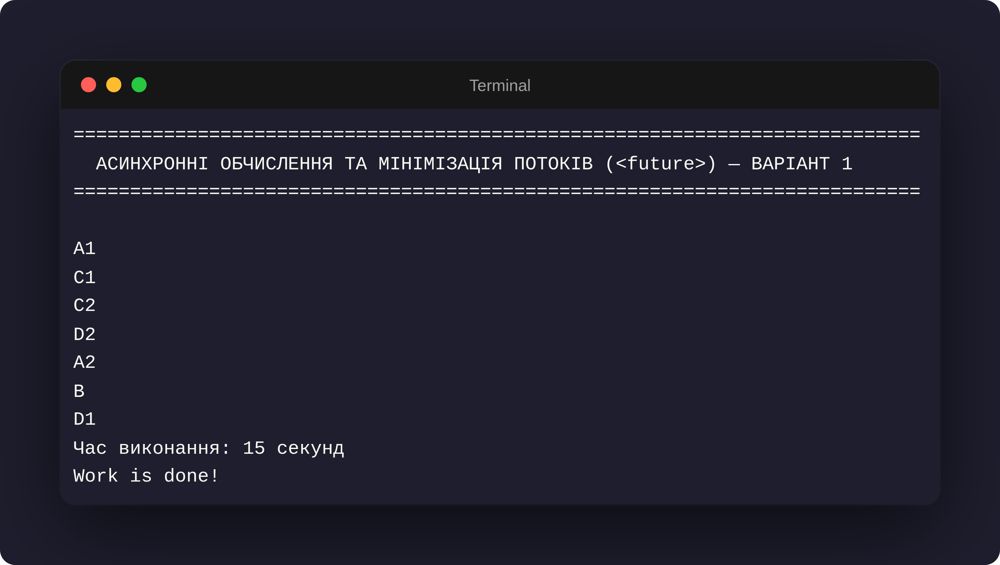

# Програмний проєкт 5. Засоби асинхронного виконання мови С++. Оптимізація обчислювальних схем з використанням `<future>`.

## Задача 1: Оптимізація асинхронного виконання обчислювальної схеми (Варіант 1)

* **Виконав:** Величко Максим, група К-24
* **Цільовий стандарт:** C++23
* **Компілятор:** GCC 15.2+
* **Система збирання:** CMake 3.20+

---

## 1. Постановка задачі (Варіант 1)

Необхідно оптимізувати обчислювальну схему для виконання наборів дій з мінімальним загальним часом роботи, мінімальною кількістю одночасно працюючих потоків та мінімальною кількістю запусків нових потоків за допомогою засобів бібліотеки `<future>`.

* **Усі обчислення:** $A1, A2, B, C1, C2, D1, D2$ (всього 7 обчислень).
* **Повільні обчислення (7 с):** $A2, B$.
* **Швидкі обчислення (1 с):** $A1, C1, C2, D1, D2$.
* **Залежності між обчисленнями:**
  * $B(A1, A2)$ — $B$ залежить від $A1$ та $A2$.
  * $D1(B, C1)$ — $D1$ залежить від $B$ та $C1$.
  * $D2(C2)$ — $D2$ залежить від $C2$.

---

## 2. Схема виконання, розподілу по потоках та точок синхронізації

```text
Час (с) | Головний потік               | Додатковий потік (std::async) | Точки синхронізації / Події
--------+------------------------------+-------------------------------+---------------------------------------
  0 - 1 | A2 (slow, 7s — частина 1)    | A1 (quick, 1s)                | Старт: main запускає async потік
  1 - 2 | A2 (slow, 7s — частина 2)    | C1 (quick, 1s)                | A1 завершено (t=1)
  2 - 3 | A2 (slow, 7s — частина 3)    | C2 (quick, 1s)                | C1 завершено (t=2)
  3 - 4 | A2 (slow, 7s — частина 4)    | D2 (quick, 1s)                | C2 завершено (t=3)
  4 - 7 | A2 (slow, 7s — частина 5)    | — (завершено)                 | D2 завершено (t=4), фоновий потік вільний
  7     | [Check A1]: A1 готове        | —                             | A2 завершено (t=7). B(A1, A2) готова!
  7 - 14| B (slow, 7s)                 | —                             |
 14     | [Sync]: future_bg.get()      | —                             | B завершено (t=14). D1(B, C1) готова!
14 - 15 | D1 (quick, 1s)               | —                             | D1 завершено (t=15)
 15     | Work is done!                | —                             | Загальний час: 15 секунд
```

---

## 3. Математичне обґрунтування оптимальності

1. **Мінімальний час обчислення (Критичний шлях):**
   * Критичний шлях визначається послідовністю залежностей $A2 \to B \to D1$.
   * Час критичного шляху: $T_{\min} = 7\,\text{с} (A2) + 7\,\text{с} (B) + 1\,\text{с} (D1) = 15\,\text{секунд}$.
   * Скоротити підсумковий час виконання нижче 15 секунд теоретично неможливо.

2. **Мінімальна кількість потоків та запусків:**
   * Усі інші 4 швидких обчислення ($A1, C1, C2, D2$) сумарно потребують $1 + 1 + 1 + 1 = 4\,\text{секунди}$.
   * Запуск **лише одного додаткового потоку** через `std::async` на початку роботи дозволяє повністю виконати ці 4 обчислення за інтервал $t = 0 \dots 4$ с паралельно з виконуваним $A2$ на Головному потоці ($t = 0 \dots 7$ с).
   * Одночасно працює **максимум 2 потоки** (Main + 1 async), і здійснюється **лише 1 запуск нового потоку** за весь час роботи програми.

---

## 4. Реалізація асинхронних засобів C++23

* **Асинхронний запуск та синхронізація (`<future>`):**
  * `std::async(std::launch::async, ...)` — запуск фонової послідовності в окремому потоці.
  * `std::future::get()` — очікування завершення фонових робіт для гарантування готовності $C1$ перед запуском $D1$.
* **Синхронізація виводу (`std::osyncstream`):**
  * Запобігає кашам чи перемішуванню символів при одночасному виводі в `std::cout` з декількох потоків.
* **Обробка винятків (Exception Safety):**
  * Усі асинхронні блоки огорнуті в `try-catch` у функції `work()` та в `main()`.

---

## 5. Структура проєкту

```text
├── CMakeLists.txt          # Конфігурація збирання (C++23, Threads)
├── main.cpp                # Точка входу, обробка винятків
├── task1.h                 # Оголошення функцій slow, quick, work
├── task1.cpp               # Реалізація оптимальної асинхронної схеми
├── screenshot.png          # Скріншот роботи програми
└── README.md               # Документація проєкту
```

---

## 6. Приклад роботи



---

## 7. Висновки

Завдяки побудованій схемі вдалося досягти абсолютно мінімального часу виконання **15 секунд** при мінімально можливих ресурсах: залучено всього **2 потоки** (основний та 1 фоновий) та здійснено **лише 1 асинхронний запуск**.